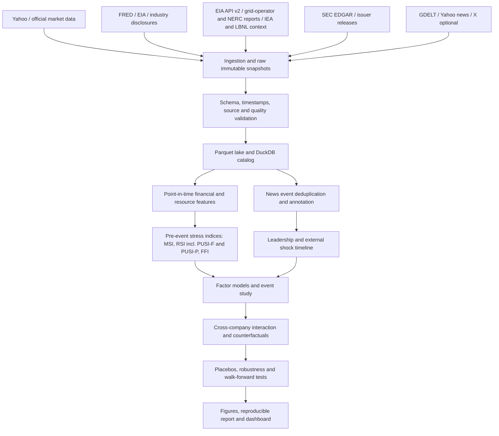

# State-Dependent Shock Amplification: NVIDIA Leadership News and Market Resilience

**Research design and implementation plan**  
**Version:** 1.8 (v1.1 power/utilities; v1.2 point-in-time alignment with `CLAUDE.md`; v1.3 external review; v1.4 second review; v1.5 H6; v1.6 scope tiers; v1.7 vulnerability families; v1.8 leadership concentration; see Appendix A change log)  
**As-of date:** 2026-11-13  
**Primary case:** NVIDIA (NVDA)  
**Scope:** Publicly available financial, corporate, macroeconomic, industry, and news data

> **Execution priority (v1.8):** `PLAN.md` sets scope and order and wins where documents differ. H1 is the only confirmatory hypothesis. Its moderator is **leadership concentration** (LC: founder CEO, no designated successor, CEO-chair duality, from filings before T−30), called "vulnerability" only once validated; event-month fixed effects; a failed coverage gate halts H1 (no automatic fallback). H1a (misconduct × LC) is the only adverse-news amplification test; H1b (performance × LC) is reported as attenuated replacement benefit. A counterfactual frozen at the pre-E0 cutoff is required. Market stress and financial vulnerability are secondary; volatility is a control. NVIDIA is described on four vulnerability families, never combined. Where older sections use MSI as the H1 moderator, read them as the secondary specification. The spec card below must match `configs/preregistration.yaml`.

```yaml spec-card
version: "1.8"
primary_hypothesis: H1
outcome: "CAR[-1,+1]"
primary_moderator: leadership_concentration
primary_terms: ["performance:LC", "misconduct:LC"]
term_labels: {"misconduct:LC": H1a_adverse_news_amplification, "performance:LC": H1b_attenuated_replacement_benefit}
baseline: voluntary
direction: negative
adjustment: holm
family_alpha: 0.05
fixed_effects: event_month
sample_period: ["2005-01-01", "2025-12-31"]
moderator_lag_sessions: 30
coverage_gate: {overall: 0.80, misconduct: 0.70}
coverage_gate_failure: halt_and_decide_outcome_blind
freeze_gate: step_4b
session_close: "NYSE scheduled close, America/New_York (16:00; 13:00 early close)"
event_time: earliest_public_source
date_only_window_start: -1
nvidia_families: [financial, leadership, operational, resource_deployment]
nvidia_combined_score: false
nvidia_pre_e0_counterfactual: required
```

## 1. Research problem

Can a company and its surrounding financial ecosystem absorb negative leadership news during a low-stress regime but experience a disproportionately large valuation response to comparable news during a high-stress regime?

The motivating case is NVIDIA's November 2026 leadership transition. The research must not assume that the observed stock decline was caused entirely by Jensen Huang-related news, nor that the decline would have occurred anyway. It must estimate the extent to which pre-existing market, resource, and industry stress altered the reaction to the news.

**Primary question:** Does accumulated financial and operational stress reduce a company's resilience to leadership shocks, amplifying abnormal stock returns after controlling for shock severity and ordinary market movements?

**Counterfactual question:** How would a shock comparable in content and severity to the November 2026 NVIDIA leadership news have affected NVIDIA under its market and industry conditions approximately one year earlier?

**Boundary:** This is an empirical financial-market study, not a judgment about the individuals or allegations involved. Attribute allegations to sources and distinguish allegations, verified disclosures, and confirmed corporate actions.

## 2. Hypotheses and falsification

### H1: State-dependent shock amplification (primary)

The negative abnormal-return response to adverse leadership news becomes more pronounced as **pre-event** market, resource, and company stress increases.

For news severity coded as positive for worse news, the expected interaction coefficient between news severity and stress is negative.

**Falsification:** The interaction is near zero or positive, is unstable across specifications, or fails out-of-sample and placebo tests.

### H2: Industry stress precedes leadership news

Before the first credible Jensen-related disclosure, independently measured AI-industry, supply-chain, financing, or market stress indicators had deteriorated relative to a suitable historical reference period.

**Falsification:** Pre-event indicators show no material deterioration after accounting for normal historical variation.

### H3: Incremental leadership effect

Leadership news contributes an abnormal-return component after controlling for market and industry factors. The size of this component depends on the pre-event stress regime.

**Falsification:** No identifiable incremental response, or estimates are too imprecise to distinguish from zero.

### H4: Fragility versus fundamental repricing

A high-stress response can reflect (a) temporary price overshooting, (b) a persistent revision to expected cash flows or risk premiums, or (c) a change in the market regime. Do not equate any decline with mean reversion.

**Falsification of mean-reversion subhypothesis:** No stable equilibrium relationship, no statistically credible error correction, or evidence of structural breaks incompatible with the assumed equilibrium.

### H5: Nonlinear interaction

Leadership shocks have larger effects above a stress threshold than a simple linear model predicts.

**Falsification:** Threshold or regime models do not improve out-of-sample fit relative to the linear interaction model.

### H6: Competitive spillover of a leader's leadership shock (added v1.5)

**Statement.** A negative leadership shock at a dominant firm produces positive abnormal returns for
close substitutes, and the transfer grows with competitive substitutability and with the leader's
pre-event fragility.

**Competing mechanism.** Bad news at a leader can also re-rate the whole industry (contagion: for
example, doubt about AI demand). The observed rival return is the competitive effect minus the
contagion effect (Lang and Stulz, 1992). The test is therefore a *difference*: close substitutes
versus unaffected same-industry firms, not substitutes versus zero.

**Groups (fixed from the leader's pre-event 10-K, never from returns).** For NVIDIA (10-K accepted
2026-02-25): G1 named data-center accelerator / networking competitors (AMD, Broadcom, Marvell,
Intel); G2 named suppliers (TSMC, Micron, Fabrinet; SK Hynix, Samsung, Hon Hai and Wistron are
non-US listings used only as a sensitivity with their own session mapping); G3 semiconductor firms
named in neither list; G4 cloud customers that also build in-house chips (mixed prediction).
Samsung is both supplier and competitor and is excluded from the primary groups.

**Benchmark rule.** No firm whose return is an H6 outcome may sit in any benchmark used for H6 or for
the leader's own abnormal return. Rival ARs use a SPY-only market model (primary) and SPY + G3
(sensitivity), estimated on [-252,-31] before the *first* disclosure so the whole sequence is
outside the estimation window. Inference is at group-portfolio level, because same-date ARs are
cross-correlated.

**Rebound control.** The sector sold off on 2026-11-04/05, so a later rally may be a reversal. The
cross-section of rival ARs is regressed on each firm's prior-selloff AR plus group indicators.

**Falsification.** G1 − G3 CAR is not positive across E0/E1/E2 (NVIDIA, descriptive), and in the
historical panel the rival response does not rise with substitutability (Hoberg-Phillips TNIC
similarity, availability to be verified) or with the leader's pre-event fragility.

**Status.** NVIDIA part: hypothesis-generating only, because AMD/Broadcom moves on 2026-11-12 were
reported in the news before this hypothesis was written. Historical panel (dominant firm = largest
market value in its industry at T, among the CEO-departure events): preregistered at Step 4b if
the event count supports it, otherwise exploratory. Real-economy evidence (customer contracts,
accelerator orders, market share, foundry capacity allocation) is H6b: deferred, collected only from
dated public disclosures, never used as a feature.

### Hypothesis crosswalk with the Colab implementation plan (added v1.1)

The two plans number hypotheses differently. Both numberings are kept; the implementation plan's
IDs are used in code, configs and reports. Power and utilities indicators (Section 7.2.1) are
evaluated against every hypothesis, with H2-impl and H3-impl as the primary targets.

| This plan | Implementation plan | Shared content | Power/utilities role |
|---|---|---|---|
| H1 amplification | H1 shock amplification | news severity x pre-event stress | PUSI as alternative / additional moderator (robustness) |
| H5 nonlinear interaction + H2 industry stress | H2 interacting stresses | joint stress states, non-linearity | **primary**: PUSI x MSI x shock, and PUSI-F vs PUSI-P |
| H2 industry stress precedes news + H3 incremental effect | H3 pre-news vulnerability | pre-disclosure stress, ex-ante forecast | **primary**: forecasts with vs without power variables |
| H4 fragility vs repricing (part) | H4 recovery duration | post-shock dynamics | PUSI regime as covariate in recovery models |
| H4 fragility vs repricing (mean reversion) | H5 mean reversion vs repricing | equilibrium stability | control for repricing of the AI-power trade |
| H6 competitive spillover (v1.5) | H6 competitive spillover | rival / supplier abnormal returns around a leader's shock | none planned; G2 power-equipment suppliers are not in scope |

## 3. Causal interpretation and identification challenges

Proposed causal structure:

- Pre-event market, industry, resource, and company conditions -> pre-event stress state.
- Leadership event and disclosures -> information shock.
- Pre-event stress and information shock -> stock-market reaction, potentially through an interaction.
- Leadership event -> supplier, regulatory, customer, and sector reactions -> additional indirect market effects.
- Concurrent macroeconomic and industry announcements -> both NVIDIA and control-asset returns.

**Critical distinction:** A story mentioning Jensen Huang is not necessarily a leadership shock. A story not mentioning him may nevertheless be a consequence of the crisis. Classify news by its *economic content and causal relationship*, not only by keywords.

**Key threats:**
1. Event severity differs between years. A resignation and national-security-related uncertainty cannot be treated as equivalent to routine CEO commentary.
2. The event is a sequence of disclosures, not one clean timestamp.
3. Contagion may contaminate semiconductor peers used as controls.
4. Anticipation and information leakage may shift prices before published announcements.
5. Company valuation, supply constraints, and demand can be jointly determined.
6. News archives may be incomplete and historical timestamps may reflect updates rather than first publication.
7. Daily data cannot identify intraday causal effects precisely.
8. One NVIDIA event cannot identify a general state-dependent response function; a cross-company leadership-event panel is necessary.

**Interpretation rule:** Report estimated associations and bounded counterfactuals, not certainty about an unobservable no-news world.

## 4. Study periods and units

- **Long history:** January 2015 to latest available, subject to coverage and ticker inception dates.
- **Main cross-company panel:** January 2018 to latest available, with sensitivity tests for 2015 onward.
- **NVIDIA case:** A complete timeline of credible public disclosures in October-November 2026, with an event date defined by the **earliest verified market-accessible disclosure**, not automatically the resignation announcement.
- **Historical comparison:** November 2025 or a matched low-stress period. Match on relevant state variables instead of assuming calendar-year comparison is sufficient.
- **Return frequencies:** Daily for the full panel; intraday 5-minute or 15-minute only where legally accessible and with reliable timestamps.
- **Event windows:** Intraday if available; otherwise [-1,+1], [0,+1], [0,+3], [0,+5], and [0,+10] trading days, with overlapping news windows flagged. Windows starting at 0 are used only when the announcement time of day is known; date-only events use the same windows started at −1 (v1.2).
- **Observation units:** Stock-day, firm-event, article-event, and firm-quarter.

## 5. Public datasets to download

| Dataset | Variables | Public source | Access method | Limitations / use |
|---|---|---|---|---|
| Equity and ETF prices | Adjusted OHLCV, dividends, splits, timestamps | Yahoo Finance | `yfinance` for research prototypes; verify against exchange/issuer data | Unofficial API, incomplete intraday history, licensing/reliability limitations |
| NVIDIA | NVDA | Yahoo Finance | Historical daily prices | Target, never included in peer index |
| Semiconductor peers | TSM, ASML, AMAT, LRCX, MU, AMD, AVGO, AMKR, KLAC | Yahoo Finance | Historical daily prices | Exclude NVDA from sector proxy; company-specific news may contaminate controls |
| Asian memory suppliers | SK Hynix `000660.KS`, Samsung `005930.KS` | Yahoo Finance | Historical local-market prices | Time-zone and currency adjustments required |
| Power and infrastructure | VRT, ETN, PWR, EQIX, DLR | Yahoo Finance | Historical daily prices | Proxy for resource exposure, not physical resource scarcity |
| AI demand / hyperscalers | MSFT, AMZN, GOOGL, META, ORCL | Yahoo Finance | Historical daily prices | Demand proxies; potentially affected by NVIDIA news |
| Market benchmarks | SPY, QQQ, SOXX, SMH | Yahoo Finance | Historical daily prices | SOXX/SMH contain NVIDIA in some periods; not clean independent controls |
| Implied volatility | VIX (`^VIX`), Nasdaq-100 volatility (`^VXN`) | Cboe / Yahoo Finance | Official Cboe historical series where available, Yahoo prototype | Options-based expectations, not direct realized instability |
| Financial stress | STLFSI4, corporate spreads, rates | Federal Reserve Bank of St. Louis FRED | FRED API or CSV download | Weekly release lags; point-in-time vintage considerations |
| Treasury yields | DGS2, DGS10, SOFR-related series | FRED | FRED API / CSV | Align by observation and publication date |
| NVIDIA financials | Revenue, gross margin, inventory, receivables, cash flow, capex, geographic/segment notes | SEC EDGAR XBRL and filings | `data.sec.gov` companyfacts and submissions JSON; filings | Reported with lags; use filing dates and original versions |
| Peer financials | Same as above for comparables | SEC EDGAR | Companyfacts JSON, filings | Accounting differences, non-US issuers, reporting frequency |
| Leadership/governance events | CEO departures, board changes, 8-K Item 5.02 | SEC EDGAR and issuer newsrooms | Filing metadata and issuer press releases | Not every news event has an SEC filing |
| Industry capacity / bottlenecks | Foundry capacity, packaging, HBM supply, lead times, customer concentration | TSMC, Micron, ASML, SK Hynix, Samsung investor releases and filings | Public PDFs, earnings transcripts where available | Sparse, qualitative, inconsistent definitions; cannot infer precise physical shortage from stock prices |
| Data-center demand | Hyperscaler capex, AI infrastructure guidance | SEC filings of MSFT, AMZN, GOOGL, META, ORCL | XBRL and quarterly reports | Capex is an imperfect AI-specific demand proxy |
| Electricity and infrastructure | Electricity prices, generation, grid demand | EIA, FRED | Public CSV/API | Geography and industry attribution may be weak |
| Historical news | Headline, publisher, original publish time, URL, article topic | GDELT 2.0 / DOC, Google News discovery, issuer newsrooms | Public query endpoints / archival records | Coverage and timestamp accuracy vary; full text often restricted |
| NVIDIA-specific news | Jensen, leadership, CUDA, AI demand, exports, financing | Yahoo Finance news discovery, GDELT, publisher pages | Metadata retrieval and source verification | Yahoo news is not a complete historical archive |
| Social discussion | X posts, reposts, author metadata, timestamp, engagement | X API, subject to access rights | Official API only if archive access and budget permit | Historical access, pricing, bot bias, sampling; optional, not a core dependency |
| Investor attention | Search interest for NVIDIA / Jensen Huang | Google Trends | Download/export for selected queries | Normalized, sampled series, limited resolution |

**Source priority:** SEC/issuer filings and official market/macroeconomic data for factual events; licensed or openly accessible metadata for news; Yahoo for reproducible price-data prototyping. Never store copyrighted full articles without appropriate rights.

### Initial ticker basket

```
TARGET = ["NVDA"]
SEMICONDUCTORS = ["TSM", "ASML", "AMAT", "LRCX", "MU", "AMD", "AVGO", "AMKR", "KLAC"]
MEMORY_ASIA = ["000660.KS", "005930.KS"]
POWER_INFRA = ["VRT", "ETN", "PWR", "EQIX", "DLR"]
AI_DEMAND = ["MSFT", "AMZN", "GOOGL", "META", "ORCL"]
BENCHMARKS = ["SPY", "QQQ", "SOXX", "SMH", "^VIX", "^VXN"]
# added v1.1 (all verified on Yahoo Finance 2026-11-13; first available date in brackets)
UTILITIES = ["XLU",   # Utilities Select Sector SPDR ETF [1998-12-22]
             "^UTY"]  # PHLX Utility Sector Index [1990-01-02], price index
POWER_EQUIPMENT = ["GRID",  # First Trust Nasdaq Clean Edge Smart Grid Infrastructure ETF [2009-11-17]
                   "ETN", "VRT", "PWR"]  # [1990-01-02], [2018-08-02], [1998-02-12]
PLACEBO_SECTORS = ["XLP", "XLV"]  # negative controls (Section 8.8)
# S&P 500 Utilities Index (^SP500-55): Yahoo returns only the current bar (no history) ->
# UNAVAILABLE from free sources; XLU (which tracks it) is the documented proxy.
```

PUSI-F basket composition changes over time because of listing dates: a **core** basket (XLU,
^UTY, ETN, PWR) from 2005, + GRID from 2009-11, + VRT from 2018-08. Each composition change is
logged, and results are reported for the core basket over the full period and for the full basket
from 2018-08.

Avoid survivorship bias by recording delisted firms and historical index membership where feasible. An equal-weighted current-ticker basket is an exploratory proxy, not a historically unbiased investable index.

## 5.1 Power, utilities and electricity-infrastructure datasets (added v1.1)

All entries were checked against live endpoints or official pages on 2026-11-13. The status column
records what was verified. Anything not verified is marked and is not used until Stage 00 of the
implementation plan confirms it. Machine-readable mirror: `configs/power_sources.yaml`.

**Common rules for every dataset.**
- Missing values stay missing. No interpolation, backfill or centered smoothing.
- Lower-frequency values reach the session grid only through an as-of join on the *availability*
  timestamp. The value carries forward up to a per-series `max_age`, then becomes missing.
- Duplicates on (identifier, period) are a FAIL.
- Units are canonicalized and checked.
- Outliers are flagged and never deleted automatically.

### A. Financial-market indicators (PUSI-F; placebo controls)

| Dataset | Source / method | Identifier | Freq | Coverage (verified) | Units | License / limits | Point-in-time | Status |
|---|---|---|---|---|---|---|---|---|
| Utilities Select Sector SPDR ETF | Yahoo Finance via `yfinance` | `XLU` | daily | 1998-12-22 → present | USD; adjusted close (dividends + splits) | Yahoo terms: research prototype, no redistribution of raw data | available at the 16:00 ET session close | verified |
| PHLX Utility Sector Index | Yahoo via `yfinance` | `^UTY` | daily | 1990-01-02 → present | index points; **price index** (no dividends) | as above; Nasdaq index data | session close | verified |
| S&P 500 Utilities Index | Yahoo `^SP500-55` | — | — | **current bar only, no history** | — | S&P DJI index data is licensed | — | **unavailable** (proxy: XLU) |
| First Trust Nasdaq Clean Edge Smart Grid Infrastructure ETF | Yahoo | `GRID` | daily | 2009-11-17 → present | USD adj. close | Yahoo terms | session close | verified |
| Eaton | Yahoo | `ETN` | daily | 1990-01-02 → present | USD adj. close | Yahoo terms | session close | verified |
| Vertiv | Yahoo | `VRT` | daily | 2018-08-02 → present (SPAC-era history included; check the listing change) | USD adj. close | Yahoo terms | session close | verified |
| Quanta Services | Yahoo | `PWR` | daily | 1998-02-12 → present | USD adj. close | Yahoo terms | session close | verified |
| Consumer Staples SPDR (placebo) | Yahoo | `XLP` | daily | ≥ 2015 confirmed | USD adj. close | Yahoo terms | session close | verified for 2015+; full start date checked at Stage 00 |
| Health Care SPDR (placebo) | Yahoo | `XLV` | daily | to verify | USD adj. close | Yahoo terms | session close | **to verify at Stage 00** |

Missing sessions for active tickers are flagged and not filled. No values exist before a listing date, and none are backfilled.

### B. Physical electricity indicators (PUSI-P)

| Dataset | Source / method | Identifier | Freq | Coverage (verified) | Units | License | Point-in-time availability | Missing / revisions | Status |
|---|---|---|---|---|---|---|---|---|---|
| Retail electricity price and sales by state and sector | EIA API v2, free key (`EIA_API_KEY`); max 5,000 rows/call | route `electricity/retail-sales`; facets `stateid`, `sectorid`; data `price`, `sales` | monthly | 2001-01 → 2026-08 | price cents/kWh; sales million kWh | US government, public domain | No release date in the API rows. Use the Electric Power Monthly release date for the data month (e.g. Aug-2026 data released 2026-10-23; about a 2-month lag). Log each release date at ingestion | Current values only, no vintages: flag `current_vintage_only`. Preliminary values are revised | verified |
| Generation and fuel consumption (EIA-923) | EIA API v2 | `electricity/electric-power-operational-data`; facets location, sector, fuel | monthly | 2001-01 → 2026-08 | generation MWh / thousand MWh; fuel in physical units and MMBtu | public domain | Electric Power Monthly release rule (as above) | as above | verified |
| Balancing-authority hourly demand, day-ahead forecast, net generation, interchange (EIA-930) | EIA API v2, plus bulk files for full history | `electricity/rto/region-data` (and `daily-region-data`); `type` = D, DF, NG, TI; facet `respondent` (BA) | hourly / daily | API from 2019-01-01; bulk from 2015-07-01 | MWh, hour-ending | public domain | D is published about 1 hour after the hour; DF by about 11:00 ET the same day; NG/TI by about 11:00 ET the next day. A day is used only once complete and published. Daily data are aggregated in a fixed timezone and the choice is stated | Values are re-collected the next day and anomalies are corrected; no vintages, so flag. Gaps per BA stay missing; BA coverage is logged | verified |
| Operating generator capacity (EIA-860M) | EIA API v2 | `electricity/operating-generator-capacity` | monthly | 2008-01 → 2026-08 | MW (nameplate, net summer, net winter) | public domain | No release timestamp in the rows. Use a conservative 2-month lag until the 860M release schedule is confirmed at Stage 00 | revisions possible; aggregation to US/BA documented | verified |
| Average price of electricity per kWh, US city average | FRED (BLS) | `APU000072610` | monthly | 1978-11 → 2026-10 | USD/kWh | FRED/BLS public | BLS CPI release date. Use ALFRED `realtime_start` (FRED API key) for the exact first-release date | ALFRED vintages | verified |
| CPI: electricity, US city average (SA) | FRED (BLS) | `CUSR0000SEHF01` | monthly | 1952-01 → 2026-10 | index | public | CPI release date via ALFRED | seasonal factors revised; use vintages | verified |
| PPI: electric power generation, transmission and distribution | FRED (BLS) | `PCU22112211` | monthly | verified to exist (coverage logged at Stage 00) | index | public | PPI release date via ALFRED | vintages | verified (ID) |
| PPI: industrial electric power | FRED (BLS) | `WPU0543` | monthly | 1958-01 → 2026-10 | index | public | PPI release via ALFRED | vintages | verified |
| Industrial production: electric power G/T/D | FRED (Fed G.17) | `IPG2211S` | monthly | 1972-01 → 2026-09 | index 2017=100 | public | G.17 release via ALFRED | substantial revisions; use vintages | verified |
| Capacity utilization: electric power G/T/D | FRED (Fed G.17) | `CAPUTLG2211S` | monthly | 1967-01 → 2026-09 | % of capacity | public | G.17 release via ALFRED | vintages | verified |
| Henry Hub natural gas spot (fuel-cost driver, control) | FRED (EIA) | `DHHNGSP` | daily | 1997-01-07 → 2026-11-11 | USD/MMBtu | public | ALFRED `realtime_start` (published with a lag) | vintages | verified |
| PJM capacity-market (BRA) clearing prices | PJM RPM results: summary XLSX + per-auction PDF reports | RTO and LDA clearing price by delivery year | about 1 per delivery year | DY 2007/08 → 2028/29 | $/MW-day (UCAP) | No license stated: store derived values with citation, do not redistribute the file | **Report date** is the availability date (e.g. DY2025/26: 2024-07-30; DY2026/27: 2025-07-22; DY2027/28: 2025-12-17; DY2028/29: 2026-07-14) | step function between auctions; regional (PJM only) | verified |
| Interconnection queue backlog | LBNL *Queued Up* (Berkeley Lab EMP), XLSX per edition | `lbnl_ix_queue_data_file_thru2025.xlsx` (2026 edition) and prior editions | about annual | editions through end-2025 data (published 05/2026) | MW / GW by status, ISO, type; time in queue | **CC BY 4.0** (attribute LBNL and GridTracker) | **Edition publication date**; older editions act as vintages | annual snapshots only; queue definitions change between editions (log) | verified |
| Reliability assessments (LTRA, SRA, WRA) | NERC, PDF only | assessment-area risk ratings, anticipated reserve margins | LTRA annual; SRA May; WRA November | e.g. 2025 LTRA dated Jan 2026; 2025–26 WRA Nov 2025; 2026 SRA May 2026 | % reserve margin; ordinal risk level | license not checked: cite, extract numbers only | Publication month. Use the month end unless the exact date is verified | no machine-readable tables: manual extraction with reviewer and page reference | verified (PDFs); terms to check |

### C. Context only: data-center electricity estimates and projections (never used as regressors)

| Dataset | Source | Content | License | Status |
|---|---|---|---|---|
| LBNL *2024 United States Data Center Energy Usage Report* (LBNL-2001637, DOI 10.71468/P1WC7Q, published 2024-12-19) | eta-publications.lbl.gov / eScholarship | US data centers ≈176 TWh in 2023 (4.4% of US electricity); 2028 scenarios ≈325–580 TWh (6.7–12.0%) | US Government license reserved; built on proprietary inputs. Cite the eScholarship copy | verified; PDF only, `is_projection` |
| IEA *Energy and AI* (2025) report and data product | iea.org | world and regional data-center electricity, projections to 2030/2035 | Report CC BY 4.0; **data product under IEA non-CC terms (per search snippets)** | **unverified** (site refused automated access); manual check needed before use |
| EIA data-center electricity series | EIA | No dedicated series exists. Only AEO2026 model estimates in Today in Energy (2026-05-19) | public domain | **no series**: commentary only |

### D. Checked and excluded (with reasons)

| Source | Reason |
|---|---|
| PJM Data Miner 2 API | Needs an account; terms prohibit redistribution of derived data without PJM membership |
| ERCOT Public API | Registration plus short-lived tokens; per-report download limits; no explicit reuse license |
| CAISO OASIS | No key needed, but only about 39 months of retention, so it cannot support a historical index; rate-limited |
| FERC Form 714 | Official pages refused automated access; annual filing lag; EIA-930 is the preferred standard source |

## 6. News ontology and labeling protocol

Each article or event must carry:

```
event_id
source_id
url
publisher
first_published_utc
last_updated_utc
first_seen_utc
market_session
entities[]
primary_topic
secondary_topics[]
leadership_related: true|false
independent_external_shock: true|false|uncertain
potential_downstream_of_leadership: true|false|uncertain
shock_type: allegation|investigation|board_action|resignation|succession|regulation|earnings|supply|demand|macro|other
severity: ordinal 0..3 (annotated, not inferred from stock reaction; NVIDIA chronology labels only)
departure_type: voluntary|performance|misconduct|other (panel events; categorical, from the database code)
novelty
source_confidence
annotation_notes
```

Categories:
- **A, independent:** rates, industry capex, independent memory capacity announcements, unrelated market stress.
- **B, leadership:** verified reporting about Jensen Huang, governance, board decisions, succession, official resignation.
- **C, potentially downstream:** analyst reactions, customer/supplier statements, policy developments or market narratives plausibly triggered by leadership news.
- **D, mixed/uncertain:** overlapping causal pathways; retain uncertainty rather than forcing a binary label.

Use deterministic rules for initial candidate retrieval, then a lightweight language model or human annotation for classification. Sample and manually review at least 200 stratified articles/events, or all events if fewer. Measure per-class precision, recall, F1, inter-annotator agreement, and timestamp error. Do not train sentiment labels using future price movements.

**First-publication audit:** For every high-impact event, compare publisher timestamp, SEC acceptance time, issuer release time, and first archival appearance. Preserve time-zone conversions and premarket/after-hours classification. The SEC filing dated November 12 states the board accepted the resignation November 11, illustrating why event date, filing date, and public disclosure date are not interchangeable.

## 7. Stress measurement

Construct distinct, pre-event measures rather than one opaque index.

### 7.1 Market Stress Index (MSI)

Candidate inputs: 20/60-day realized volatility of a broad benchmark, VIX/VXN, downside semivariance, rolling maximum drawdown, credit spreads, STLFSI4, correlation concentration, and a liquidity proxy.

- Standardize using a trailing historical training window only.
- Prefer variables that do not mechanically contain NVDA or explicitly remove NVDA exposure where possible.
- Avoid using NVIDIA's own return/drawdown as a predictor of its contemporaneous abnormal return.
- Use weekly or daily last-known values with release-aware joins.

### 7.2 Resource and Industry Stress Index (RSI)

Candidate inputs: semiconductor supplier lead-time/capacity disclosures, HBM availability, advanced packaging bottlenecks, changes in hyperscaler capex guidance, electricity/infrastructure cost and availability, supplier margins, inventory-to-sales, and market-based supplier stress proxies.

- Separate observed physical constraints from **market-implied** stress proxies.
- Record which variables represent scarcity that benefits NVIDIA's pricing power versus scarcity that restricts shipment volume.
- Sparse qualitative disclosures require transparent ordinal scoring with a coding manual.
- Supplier equity returns alone are not direct measurements of resource scarcity.
- RSI is reported as named components (semiconductor supply, memory, **power and utilities**), never
  only as a single total.

### 7.2.1 Power and Utilities Stress Index (PUSI), a separate RSI component (added v1.1)

**Motivation.** AI data-center build-out depends on grid interconnection, generation capacity and
electricity prices. If power is the binding constraint, then deteriorating power conditions may
raise the market's sensitivity to NVIDIA-specific news (fewer deployable GPUs, slower revenue
conversion). This is a hypothesis to test, not an assumption.

PUSI has two families that are **built, reported and tested separately**, and only combined in a
documented sensitivity analysis:

| Family | Meaning | Inputs (verified identifiers in Section 5.1) | Cadence |
|---|---|---|---|
| **PUSI-F** (financial-market) | What equity markets price about power and utilities | XLU, ^UTY, GRID, ETN, VRT, PWR returns, relative performance vs SPY and vs the ex-NVDA semis basket, realized volatility, drawdown, and rolling correlation with NVDA | daily |
| **PUSI-P** (physical) | Measured state of electricity supply and demand | EIA retail price and sales, generation and operating capacity, EIA-930 balancing-authority demand vs forecast, FRED electricity CPI/PPI and utility capacity utilization, capacity-market clearing prices, interconnection-queue backlog, NERC reliability risk ratings | monthly / annual / event-based |
| PUSI-X (context only) | Data-center electricity demand estimates and projections | IEA *Energy and AI*, LBNL 2024 US Data Center Energy Usage Report | annual / scenario |

PUSI-X describes the narrative background. It is not used as a time-varying regressor, because
projections are revised and have only a few observation dates.

**Sign rules (not assumed; tested).**
- A rise in utility or power-equipment stock prices is **not** taken as rising stress. It can mean
  demand optimism (AI capex), lower rates (utilities behave like bonds) or sector rotation. The sign
  of each PUSI-F component relative to "stress" is defined ex ante only for unambiguous quantities
  (realized volatility, drawdown, correlation spikes). Return-level components enter as signed
  factors whose direction is estimated, and the estimated sign is reported.
- In PUSI-P, rising wholesale or retail prices, rising capacity-market clearing prices, a lengthening
  interconnection backlog, a demand-to-forecast surplus and falling reserve margins are coded as
  tighter supply. Generation-capacity additions are coded as easing.
- Each component records whether tightness is expected to *help* (pricing power of power-equipment
  suppliers) or *hurt* (deployment delays for GPU buyers) NVIDIA's cash flows. Both directions remain
  open.

**Construction.** Each component is first transformed into a stationary form (log-difference,
year-over-year change for seasonal monthly series, or deviation from a trailing 36-month median).
It is then winsorized at a 1%/99% cut-off fitted on the training window and z-scored on an expanding
window fitted only on data available at the time. Components are averaged within family with equal
weights. PCA (sign anchored by a pre-declared component) and shrinkage weights are sensitivity
variants. **Values are joined on release date, not observation period** (EIA monthly data are
released with a lag of about two months, and capacity-auction results on their publication date). Gaps are
**never interpolated**. The last released value carries forward with a staleness counter and a
family-specific maximum age, after which the value becomes missing. A family score requires a
minimum share of its components to be present.

**What PUSI cannot do.** Physical series are monthly or slower, national or regional, and not specific
to data centers. They vary little from day to day, so they identify a regime or level, not a daily
shock. Within the cross-firm panel, PUSI is common to all firms on a date, and its relevance is
plausibly confined to AI-, semiconductor- and data-center-exposed firms. Any PUSI interaction in
the panel is therefore labelled exploratory unless the power check in Stage 6 shows adequate power.

### 7.3 Firm Fragility Index (FFI)

Candidate inputs: valuation relative to forward earnings or sales, earnings-estimate dispersion where accessible, concentration of customers/suppliers, cash conversion, inventory, implied volatility, and exposure to financing arrangements.

- Prefer independently available data and lagged accounting observations.
- Do not infer a high fragility score merely because a stock appreciated substantially.

### 7.4 Leadership Uncertainty Index (LUI)

Measure volume, novelty, severity, and uncertainty of leadership/governance news. **Do not include LUI in the pre-event moderator used to test whether independent stress amplifies leadership shocks.** It is the treatment/exposure dimension, not the pre-existing independent stress state.

### 7.5 Composite stress

PUSI-F and PUSI-P enter composites only as named, separately reported components (v1.1).

Start with transparent equal-weighted standardized indices. Compare against PCA and a shrinkage-weighted index. Publish all constituent series and sensitivity to weight choices. Estimate threshold regimes from training data only. Do not optimize index weights to maximize the November 2026 effect.

## 8. Econometric and causal methodology

### 8.1 Baseline market model

Estimate NVIDIA and peer expected returns using pre-event market and leave-NVIDIA-out industry factors:

```
r_i,t = alpha_i + beta_m r_market,t + beta_s r_sector_ex_NVDA,t
        + beta_r' resource_factor_returns_t + error_i,t
```

Use Newey-West or suitable heteroskedasticity/autocorrelation-robust inference, rolling estimates, and collinearity diagnostics. Factors based on peer prices are exposure controls, not proof of physical causation.

### 8.2 Event abnormal returns

```
AR_i,t = observed_return_i,t - predicted_return_i,t
CAR_i,[a,b] = sum_t AR_i,t
```

Calculate for the first public report, major subsequent disclosures, and official corporate action. Adjust for market hours, overlapping events, and concurrent earnings or policy announcements. Report uncertainty intervals and event-study assumptions.

### 8.3 Cross-company state-dependent panel (primary identification)

Build a panel of technology-sector leadership shocks, including CEO resignations, unexpected departures, governance investigations, and succession announcements. Annotate severity and whether the event is voluntary, forced, planned, or accompanied by legal/regulatory concerns.

```
CAR_i,e = alpha + beta_N NewsSeverity_i,e + beta_S Stress_i,e_pre
          + beta_NS NewsSeverity_i,e * Stress_i,e_pre
          + firm_controls + event_controls + year_effects + error_i,e
```

**v1.3 primary specification (categorical event type).** Severity enters as categories, not as an
equally spaced score: voluntary/planned departure (baseline), performance dismissal, misconduct
dismissal.

```
CAR_i,e = alpha + g_P Perf + g_M Misc + beta_S Stress_pre + d_P Perf*Stress_pre + d_M Misc*Stress_pre
          + controls(as of T) + error
```

Primary tests: d_P < 0 and d_M < 0, Holm-adjusted at family α = 0.05. Secondary: the pooled
dismissal contrast, d_M = d_P, and the ordinal score. Controls (all as of T): CEO tenure, founder
status, planned vs surprise, successor named in the announcement, size, sector, prior return; each
control × stress as robustness. Step 0b power (synthetic outcomes, real counts): the pooled and
ordinal tests fail when only misconduct amplifies; separate Holm-adjusted tests cost ≈10% in MDE and
work in every scenario tested; the misconduct test detects only ≥1.3–2.6 pp before Holm.

**Resilience outcomes (v1.3).** R1 immediate CAR[−1,+1] (primary); R2 additional damage, min over
k∈[+2,+20] of CAR[−1,k] − CAR[−1,+1], judged against placebo events because its null mean is
negative; R3 recovery time (Section 8.5 / H4).

- **v1.1 form, kept as a secondary specification:** beta_NS with an ordinal severity score. The primary test is the v1.3 categorical specification above.
- **v1.4 interpretation.** d_P and d_M compare dismissals with voluntary departures, which are not neutral events. Each type's total stress slope (beta_S + d_k) is reported with its CI against a matched non-event baseline (pseudo-event dates from the same firm, year and stress tercile). "Absolute amplification" is claimed only if a type's slope is below the non-event slope; otherwise the claim is "amplification relative to voluntary departures".
- **v1.4 R2 sample.** Full sample with a competing-event indicator; the uncontaminated subsample and censoring at the first competing event are sensitivities. Unscheduled later disclosures are never controls (they can be caused by the crisis).
- **v1.4 power.** Before any H1 estimate, power is re-simulated on the retained sample (controls, missing data, month clustering, residual variance from estimation windows and placebo dates only); MDEs by type go into the frozen preregistration.
- Cluster standard errors by firm and calendar period as appropriate; assess sensitivity with bootstrap/randomization inference.
- Include firm size, valuation, prior performance, sector, news severity, planned versus surprise succession, and concurrent disclosures.
- Compare matched low-stress and high-stress events using propensity weighting/matching as a robustness check, not as a substitute for identification.
- Evaluate whether the panel has enough events for meaningful power. If not, label conclusions exploratory.

### 8.4 NVIDIA counterfactuals

**A. Pre-disclosure forecast:** Freeze a model before the earliest credible leadership report; forecast subsequent NVDA returns using only information available then. This is clean but grows uncertain with horizon.

**B. Conditional external-shock forecast:** Condition on later independent macro/industry shocks while excluding leadership-related and plausibly downstream shocks. This requires stronger assumptions and contamination tests.

**C. Historical-state transport:** Estimate a comparable leadership-shock response in a low-stress period such as 2025 using the cross-company panel. Keep shock severity fixed and change only pre-event stress inputs. This is a model-based counterfactual, not an observed 2025 Jensen event.

Report all three and the extent to which they agree. Use synthetic control only with donor firms not materially exposed to the event, and compare donor exclusions.

### 8.5 Nonlinearity and regime models

Compare:
1. Linear news × stress interaction.
2. Stress quantile interactions.
3. Threshold regression.
4. Markov-switching or time-varying parameter model if data support it.

Use blocked/walk-forward validation and penalize complexity. Never select a regime boundary by inspecting the target event alone.

### 8.6 Mean reversion as a secondary hypothesis

Define a meaningful state variable, e.g., log valuation relative to a peer- and fundamentals-adjusted benchmark. Test stability with ADF/KPSS, cointegration/error-correction where applicable, and structural-break tests. Estimate adjustment speed only if a stable equilibrium is supported. A falling price is not itself evidence of mean reversion.

### 8.7 Incremental value of power and utilities indicators (added v1.1)

The question is whether power indicators add information beyond market, sector and macro
stress, for each hypothesis. Nested models are compared on identical samples:

| Model | Regressors / moderators |
|---|---|
| M0 baseline | market, ex-NVDA sector, MSI (and FFI where used) |
| M1 | M0 + PUSI-F |
| M2 | M0 + PUSI-P |
| M3 | M0 + PUSI-F + PUSI-P |
| M1-orth | M0 + PUSI-F orthogonalized to market, AI-demand and rates factors (see 8.8) |

**Validation.** Rolling-origin (walk-forward) evaluation with an expanding training window and a fixed
step and horizon, measured in trading sessions. Every scaler, PCA, winsorization limit and
hyperparameter is fitted inside each fold's training window, and hyperparameters are tuned with a
nested time split. Overlapping-horizon targets are separated by an embargo of at least the horizon
length.

**Metrics.** RMSE and MAE; pinball loss / CRPS for predictive distributions; empirical 80% and 95%
interval coverage; Diebold-Mariano tests (HAC variance) for the M0-vs-Mk loss difference; a block
bootstrap CI of the loss difference; for panel models, the change in the interaction coefficient
and its clustered CI.

**Coefficient stability.** Rolling and fold-wise coefficients with CIs, the fraction of folds with the
same sign, CUSUM / Chow tests at pre-declared candidate break dates (for example the start of the AI
capex cycle), and leave-one-year-out estimates.

**Decision rule (preregistered).** A power indicator "improves" a hypothesis test only if (a) the
out-of-sample loss difference favours Mk, with a block-bootstrap 95% CI that excludes 0, (b) the sign
is the same in at least 75% of folds, (c) the gain survives the negative controls in 8.8, and (d) the
gain holds using point-in-time-valid inputs only (market prices, ALFRED vintages, dated reports);
a gain that needs `current_vintage_only` series (e.g. EIA data, which have no vintages) is reported
as "revised-data, exploratory" (v1.2).
Otherwise the result is reported as "no incremental value" or "inconclusive", with the CI.

### 8.8 Negative controls and robustness for power indicators (added v1.1)

These tests separate genuine power-resource constraints from broad equity moves, common
AI-investment sentiment, interest rates and valuation effects:

1. **Market orthogonalization.** Regress PUSI-F components on SPY and QQQ returns within each training
   fold and use the residuals. If the gain disappears, it was broad-market co-movement.
2. **AI-sentiment control.** Add an ex-NVDA AI-demand basket (hyperscalers) and ex-NVDA semis factor.
   A power effect must survive conditioning on common AI-trade sentiment.
3. **Rates control.** Utilities behave like bonds. Add changes in DGS10/DGS2 and a REIT factor, and
   test PUSI-F after partialling out rates.
4. **Valuation control.** Add trailing valuation and momentum of the power-equipment names. If PUSI-F
   only tracks the re-rating of AI-exposed equities, the gain is a valuation effect.
5. **Placebo sectors.** Rebuild the same index from sectors with no plausible power-constraint
   channel (for example XLP consumer staples and XLV health care). If a placebo index "improves" the
   model about as much as PUSI-F, the result is not about power.
6. **Physical-vs-financial divergence.** Periods when PUSI-F moves but PUSI-P does not are labelled
   sentiment-driven. Effects must not come only from those periods.
7. **Timing placebos.** Shift physical series forward (leads) and backward beyond their release lag.
   Leads must not help more than correctly timed values, otherwise a common trend is being picked up.
   Pseudo-event dates are drawn from the same calendar months as real events.
8. **Block permutation.** Permute PUSI in blocks of one quarter to get the null distribution of the
   out-of-sample gain.
9. **Exposure contrast (panel).** Compare power-exposed firms (semiconductors, data-center REITs,
   hyperscalers, power equipment; list fixed before outcomes are seen) with unexposed firms. A power
   channel predicts larger PUSI moderation for exposed firms.

## 9. System architecture



**Recommended CPU-friendly stack:** Python 3.11+, `pandas`/`polars`, `numpy`, `duckdb`, `pyarrow`, `yfinance`, `requests`/`httpx`, `statsmodels`, `scipy`, `scikit-learn`, `ruptures` (optional), `pytest`, `pandera` or `pydantic`, Plotly, Streamlit. Use lightweight NLP and manual labels before any expensive model fine-tuning. GPU is not required for the core econometric analysis.

**Data design:**
- `raw`: source-native JSON/CSV/PDF with retrieval time, checksum, provenance.
- `bronze`: normalized but lossless records.
- `silver`: deduplicated market/news/fundamentals tables.
- `gold`: point-in-time features, event panels, stress indices, model outputs.
- Separate `observed_at`, `published_at`, `effective_at`, `retrieved_at` timestamps.
- Version every dataset and parameter configuration.

## 10. Repository structure

```text
nvidia-stress-resilience/
  README.md
  pyproject.toml
  configs/
    sources.yaml
    tickers.yaml
    event_taxonomy.yaml
    stress_indices.yaml
    experiments.yaml
  data/
    raw/
    bronze/
    silver/
    gold/
  src/
    ingestion/
      prices.py
      fred.py
      sec.py
      news.py
      industry.py
      eia.py              # v1.1: EIA API v2 routes
      power_reports.py    # v1.1: capacity auctions, queues, NERC (curated tables)
    validation/
      schemas.py
      point_in_time.py
      corporate_actions.py
    features/
      factor_baskets.py
      market_stress.py
      resource_stress.py
      power_stress.py     # v1.1: PUSI-F, PUSI-P
      firm_fragility.py
      news_events.py
    models/
      factor_returns.py
      event_study.py
      panel_interaction.py
      counterfactual.py
      regimes.py
      mean_reversion.py
      incremental_value.py  # v1.1: M0..M3 walk-forward comparison + negative controls
    visualization/
      charts.py
      dashboard.py
  tests/
    unit/
    integration/
    statistical/
    regression/
  notebooks/
  reports/
    figures/
    event_timeline.csv
    validation_report.md
    final_report.md
  dashboard/
    app.py
```

## 11. Stage-by-stage execution and acceptance gates

### Stage 0. Preregister design and freeze definitions

**Work:** Define hypotheses, target events, shock severity rubric, stress measurement, model families, event windows, controls, and exclusion rules before examining fitted event effects.

**Tests:** Config schema validation; explicit target date/time fields; reproducibility seed; no future information in feature specifications.

**Visuals:** Research DAG and event-study timeline schematic.

**Gate:** Hypotheses and primary estimand signed off in `configs/experiments.yaml`.

### Stage 1. Acquire and validate daily market data

**Work:** Download target, peer, infrastructure, AI demand, benchmarks, VIX/VXN. Preserve raw files and corporate actions. Normalize timestamps and currencies.

**Tests:** Duplicate dates; gaps; adjusted versus unadjusted series; splits; anomalous returns; minimum coverage; ticker inception; time-zone alignment; no NVDA in independent benchmark.

**Visuals:** All-series normalized-to-100 comparison on identical weekly ticks; missingness heatmap; rolling returns and volatility.

**v1.1 additions:** Download XLU, ^UTY, GRID, ETN, VRT, PWR and placebo XLP/XLV. Record that the
S&P 500 Utilities Index is unavailable. Before: raw levels and coverage timeline per ticker.
After: utility and power-equipment performance normalized to 100 at a common start date (one chart
for the core basket since 2005, one for the full basket since 2018-08); utilities vs ex-NVDA semis
relative performance; rolling 60/120-session correlations of NVDA with each power/utility series,
raw and market-orthogonalized.

**Gate:** No unresolved critical data integrity failures; coverage report published.

### Stage 2. Acquire fundamentals, macro, and resource disclosures

**Work:** SEC financials, FRED stress and rates, hyperscaler capex, supplier disclosures, resource constraint evidence.

**Tests:** Filing dates versus fiscal period dates; units/currencies; duplicate facts; revisions; look-ahead audit; source traceability; manual audit of sparse qualitative capacity labels.

**Visuals:** Macro stress trends, supplier capacity timeline, AI capex, inventory/margins, resource proxy comparison.

**v1.1 additions (power and electricity):** Ingest the verified physical series in Section 5.1
(EIA API v2, FRED energy series, capacity-auction results, interconnection queues, NERC risk
ratings) plus the IEA/LBNL context tables. Tests: unit consistency (cents/kWh vs $/MWh, MW vs GW,
MWh vs TWh), release-date vs observation-period alignment, revisions/vintages, seasonal frequency
handling, no interpolation, staleness limits, duplicate periods, regional aggregation checks.
Before: release-lag distribution and coverage heatmap by series × year. After: electricity price,
demand (consumption, BA load) and capacity over time with release-date markers.

**Gate:** Every derived feature maps to an available-as-of timestamp and source. Every physical
power series has a verified identifier, unit and release-date rule; series that fail verification
are listed as unavailable, never replaced.

### Stage 3. Build and validate news event database

**Work:** Collect historical leadership, industry, and macro news. Deduplicate syndication, identify earliest public timestamps, label A/B/C/D causal categories, assign severity.

**Tests:** Timestamp conflict report; 200-event stratified manual review where feasible; per-class precision/recall/F1; inter-annotator agreement; label leakage checks; coverage by publisher/year.

**Visuals:** Event timeline over returns, topic intensity, category counts, severity distribution, coverage heatmap.

**Gate:** Reliable timestamp and severity annotations for all primary events, with unresolved uncertainty flagged.

### Stage 4. Build pre-event stress indices

**Work:** Construct MSI, RSI, FFI independently. Standardize on trailing windows and calculate stress regimes.

**Tests:** Component leakage; look-ahead; missingness; weight sensitivity; correlation/redundancy; structural stability; no target-return circularity.

**Visuals:** Component dashboards, stress percentiles, low/high regime bands, index contribution waterfall.

**v1.1 additions:** Build PUSI-F and PUSI-P (Section 7.2.1) as separate RSI components. Visuals:
PUSI-F and PUSI-P over time with regime bands and the NVIDIA disclosure stages marked; a
PUSI-F vs PUSI-P divergence chart; PUSI vs placebo-sector index; component correlation with MSI.
Tests: fold-wise scaler boundaries, PCA sign anchoring, staleness, no target-return circularity
(NVDA never enters PUSI), basket-composition change log.

**Gate:** Stable, interpretable indices and documented robustness across weighting schemes; PUSI
families computable as of every event cutoff, with missing values reported, not imputed.

### Stage 5. Baseline factor and abnormal-return models

**Work:** Fit market and industry factor models with rolling betas. Quantify normal residual behavior and forecast errors.

**Tests:** Residual autocorrelation/heteroskedasticity; multicollinearity; out-of-sample accuracy; comparison with market-only and peer-only baselines; blocked validation.

**Visuals:** Actual versus expected returns, rolling betas, cumulative abnormal returns, residual distribution.

**Gate:** Model beats simple baseline where feasible and inference is calibrated on historical placebo windows.

### Stage 6. Leadership-event panel and shock severity

**Work:** Assemble multi-firm historical leadership-event panel. Match severity, prior performance, and stress regimes.

**Tests:** Sample-size/power audit; event overlap; severity balance; selection bias; firm and year fixed effects; leave-one-firm-out analysis; clustered uncertainty.

**Visuals:** Stress versus CAR scatter with confidence bands; low/high-stress event distributions; forest plot of event types.

**Gate:** Enough independent events for interpretable estimates, or downgrade to exploratory analysis.

### Stage 7. Test interaction and nonlinear amplification

**Work:** Estimate `news_severity × pre_event_stress`; compare linear, quantile, and threshold models.

**Tests:** Interaction significance and effect size; sensitivity to severity rubric and stress components; bootstrap; placebo dates; multiple-testing correction; walk-forward evaluation.

**Visuals:** Predicted abnormal return against stress for fixed shock severity, marginal-effect confidence bands, regime response chart.

**v1.1 additions:** Run the M0–M3 comparison (Section 8.7) with PUSI as moderator, the
exposure contrast, and all negative controls (Section 8.8). Visuals: out-of-sample loss with and
without power variables per fold; coefficient-stability plots; negative-control forest plot.

**Gate:** Report both positive and negative findings, including uncertainty and model instability.
A power effect is claimed only under the 8.7 decision rule.

### Stage 8. NVIDIA counterfactual and 2025-state transport

**Work:** Estimate pre-disclosure, conditional no-news, and historical-state counterfactuals. Transport the *same standardized shock* to 2025 stress conditions.

**Tests:** Pre-event forecast calibration; donor contamination; alternative baskets; anticipation windows; pseudo-event placebos; varying earliest disclosure date; concurrent-news sensitivity.

**Visuals:** Actual versus counterfactual price/return paths with prediction intervals; observed-versus-2025-state response; event-by-event CAR decomposition.

**v1.1 additions:** Ex-ante NVIDIA forecasts with and without power variables (M0 vs M1–M3),
frozen at the earliest-disclosure cutoff. Because daily mean returns are close to unpredictable, the
primary targets are the **predictive distribution** (volatility and lower quantiles, scored by
CRPS/pinball and interval coverage), with the mean as secondary. Visual: NVIDIA predicted returns
and intervals with vs without power variables, against realized returns.

**Gate:** Counterfactual conclusions do not depend on a single control basket or an unverified event timestamp.

### Stage 9. Mean-reversion versus regime-change analysis

**Work:** Define fundamental valuation deviation, test equilibrium stability and adjustment after shocks.

**Tests:** Unit-root/cointegration and structural breaks; rolling parameter stability; alternative valuation denominators; sensitivity to earnings revisions.

**Visuals:** Valuation deviation with estimated equilibrium bands; regime shifts; impulse response and estimated half-life only where justified.

**Gate:** Do not claim mean reversion without a defensible stable benchmark.

### Stage 10. Replication, interpretation, and dashboard

**Work:** Freeze data manifests, rerun clean environment, produce narrative report and interactive dashboard.

**Tests:** End-to-end deterministic pipeline; checksum verification; no hidden manual steps; data provenance; alternate specification table; chart-to-table consistency.

**Visuals:** Interactive stress timeline, source/event explorer, counterfactual comparison, sensitivity controls, evidence matrix.

**Gate:** All major claims linked to data, uncertainty intervals, and reproducible code.

## 12. Primary outputs and success criteria

1. **Stress dashboard:** Pre-event resource, industry, and financial stress trajectories, with percentile bands.
2. **Verified leadership-news chronology:** Earliest reports, updates, corporate disclosures, and market session mapping.
3. **Event-panel estimate:** Marginal effect of a standardized negative leadership shock under low versus high pre-event stress, with confidence intervals.
4. **NVIDIA counterfactual:** Observed and estimated paths, with uncertainty and contamination sensitivity.
5. **2025-state simulation:** Predicted response to the same standardized shock under a matched lower-stress historical state, clearly marked as model-based.
6. **Competing-explanations matrix:** Amplification, severity difference, independent industry decline, and permanent repricing.
7. **Replication package:** Scripts, pinned dependencies, dataset manifest, validation logs, figures, and limitations.
8. **Power and utilities assessment (v1.1):** PUSI-F/PUSI-P time series, data-quality report,
   incremental-value table per hypothesis (M0 vs M1–M3), and negative-control results.

**Evidence supports the primary hypothesis only if** the estimated news × stress interaction is economically meaningful, directionally consistent across reasonable model specifications, and survives event-severity controls and historical placebo tests. Statistical insignificance is not proof of no effect; report confidence bounds and statistical power.

## 13. Practical implementation schedule

| Phase | Working days (indicative) | Deliverable |
|---|---:|---|
| Preregistration and price ingestion | 3-4 | Data manifest, synchronized price charts |
| Fundamentals, macro, resource features | 5-7 | Stress candidate database |
| Power and utilities data + PUSI (v1.1) | 4-6 | Verified power dataset, PUSI-F/P, quality report |
| News collection and annotation | 5-8 | Audited event chronology |
| Stress indices and factor models | 4-6 | Validated baselines and stress plots |
| Cross-company event panel | 6-10 | Interaction estimates and power assessment |
| NVIDIA counterfactuals | 4-6 | No-news and historical-state estimates |
| Regime/mean-reversion tests | 3-5 | Secondary mechanism analysis |
| Dashboard and replication | 3-5 | Final reproducible research package |

**Total:** Approximately 37-57 working days (v1.1, including power and utilities work) for one researcher, depending on event-data coverage and manual annotation. A useful first milestone (price data, official filings, FRED stress, preliminary event timeline) is feasible in roughly 5-8 working days. Historical news and intraday market data are the largest availability risks.

## 14. Explicit limitations

- The same real-world news cannot be experimentally replayed in 2025. The comparison is a model-based standardized-shock counterfactual.
- Leadership event severity, national-security concerns, resignation, and succession risk may be inseparable in a single case.
- Market stress and expected future cash flows can move together. An event study identifies an abnormal return conditional on assumptions, not a pure psychological fragility parameter.
- A single company-event cannot establish a general theory. Cross-firm event panels improve external validity but introduce heterogeneity.
- Public resource-capacity disclosures are sparse and can be strategically worded.
- Yahoo Finance and GDELT are useful research inputs but not guaranteed point-in-time complete or suitable for production trading decisions.
- X archive access is optional and may be costly; X trends are not representative of all investors.
- Historical index membership, delistings, and corporate actions can bias naive peer comparisons.
- Market reaction may be affected by expectations, positioning, options hedging, and forced selling that public daily data cannot fully identify.
- A decline is not necessarily mean reversion; the fundamental equilibrium may have shifted.
- (v1.1) Utility equities behave partly like bonds and like a defensive sector. An exploratory scan
  (2026-11-13) found that XLU's and ^UTY's market-adjusted correlation with NVDA closely matches
  that of the consumer-staples placebo XLP, while the power-equipment names (VRT, PWR, ETN, GRID)
  became more correlated with NVDA over 2018–2024. That pattern fits common AI-trade sentiment as
  much as a power constraint, which is why the negative controls in 8.8 are mandatory.
- (v1.1) Physical power data are monthly or slower, regional, not specific to data centers, and
  revised. Data-center demand figures (IEA, LBNL) are estimates and projections, not measurements.
- (v1.1) Power-era panel support is thin: 1,083 events since VRT listed (2018-08; 31 misconduct)
  and 229 since 2023 (6 misconduct; 28 distinct announcement months, CEO-dismissal database archival
  version). PUSI interactions in the panel are exploratory unless powered.

## 15. Verified public references and access points

These pages were opened or surfaced in a live web search on 2026-11-13. They establish accessible source entry points, not that every desired historical observation can be downloaded freely.

- NVIDIA official CEO transition announcement (2026-11-12): https://nvidianews.nvidia.com/news/nvidia-announces-ceo-transition/
- NVIDIA SEC Form 8-K, leadership transition: https://www.sec.gov/Archives/edgar/data/1045810/000104581026000082/nvda-20261111.htm
- SEC EDGAR API documentation: https://www.sec.gov/search-filings/edgar-application-programming-interfaces
- FRED St. Louis Financial Stress Index data (STLFSI4): https://fred.stlouisfed.org/data/STLFSI4
- Reuters leadership reporting (2026-11-12): https://www.reuters.com/technology/former-nvidia-ceo-huang-had-relationship-with-second-employee-sources-say-2026-11-12/
- Reuters leadership-transition coverage (2026-11-12): https://www.reuters.com/business/retail-consumer/nvidia-ceo-jensen-huang-step-down-big-blow-ai-boom-2026-11-12/

**Power and electricity sources verified 2026-11-13 (v1.1):**
- EIA Open Data API v2: https://api.eia.gov/v2/electricity/ (free key: https://www.eia.gov/opendata/register.php)
- EIA Electric Power Monthly (release calendar): https://www.eia.gov/electricity/monthly/
- EIA Today in Energy, data-center commentary: https://www.eia.gov/todayinenergy/detail.php?id=67704
- FRED series pages: https://fred.stlouisfed.org/series/APU000072610 (and CUSR0000SEHF01, PCU22112211, WPU0543, IPG2211S, CAPUTLG2211S, DHHNGSP)
- PJM RPM auction results: https://www.pjm.com/markets-and-operations/rpm
- LBNL Queued Up (2026 edition): https://eta-publications.lbl.gov/publications/queued-2026-edition-characteristics
- LBNL 2024 Data Center Energy Usage Report: https://escholarship.org/uc/item/32d6m0d1
- NERC 2025 LTRA: https://prod.nerc.com/globalassets/our-work/assessments/nerc_ltra_2025.pdf
- IEA Energy and AI (manual verification pending): https://www.iea.org/reports/energy-and-ai

**Additional acquisition endpoints to verify during Stage 1-3:** Yahoo Finance ticker history, FRED API, EIA API, GDELT DOC API, Cboe historical volatility data, issuer investor-relations pages, and X developer API documentation. Record endpoint availability, license, authentication, rate limits, and archival coverage before ingestion.

## 16. Immediate next action

Implement Stage 0 and Stage 1 first. Produce a machine-readable source manifest, download daily prices for the target and defined peer baskets, calculate adjusted log returns, verify dates and splits, build leave-NVIDIA-out sector and resource baskets, and publish one synchronized six-month chart plus a missing-data report. In parallel, establish the earliest credible Jensen-related public disclosure so that no later feature or event can leak into the pre-event stress state.

## Appendix A. Change log

### v1.1 (2026-11-13): power, utilities and electricity infrastructure

**Modified sections**

| Section | Change |
|---|---|
| Header | version 1.1 |
| 2 Hypotheses | crosswalk to the implementation plan's H1–H5 numbering and the role of power indicators per hypothesis (no hypothesis removed or changed) |
| 5 Datasets / ticker basket | UTILITIES, POWER_EQUIPMENT, PLACEBO_SECTORS groups; S&P 500 Utilities marked unavailable; basket versions by listing date |
| **5.1 (new)** | verified dataset specification (source, method, identifier, frequency, coverage, units, license, point-in-time rule, missing / revision handling, status) for financial, physical, context and excluded sources |
| 7.2 RSI | named components |
| **7.2.1 (new)** | Power and Utilities Stress Index: PUSI-F vs PUSI-P, sign rules (rising utility prices are not stress), construction, limits |
| 7.5 Composite | PUSI enters only as named components |
| **8.7 (new)** | incremental-value design: M0–M3, walk-forward, metrics, coefficient stability, decision rule |
| **8.8 (new)** | nine negative controls / robustness tests |
| 9 Architecture | power sources node; PUSI in stress indices |
| 10 Repository | `eia.py`, `power_reports.py`, `power_stress.py`, `incremental_value.py` |
| 11 Stages 1, 2, 4, 7, 8 | power additions, charts, tests, gates |
| 12 Outputs | power and utilities assessment |
| 13 Schedule | +4–6 days |
| 14 Limitations | utilities-as-defensives finding, physical-data limits, thin power-era panel |
| 15 References | verified power/electricity URLs |

The newly required datasets, tests and visualizations are listed in the implementation plan,
Section 26.

### v1.2 (2026-11-13): alignment with the project `CLAUDE.md`

The project `CLAUDE.md` was rewritten for this study. Its leakage rules (data available at T only;
join on availability time) required these changes. No hypothesis or stage was removed.

| Topic | Change |
|---|---|
| Event time | earliest verified public source (Gentry date, 8-K "date of earliest event", press-release exhibit, acceptance timestamp); `time_known` only when that source has a time of day |
| Event windows | windows starting at 0 only for `time_known` events; date-only events use windows starting at −1 |
| Session calendar | NYSE exchange calendar with 13:00 early closes, not the price index |
| Severity | announcement-day codability audit of the database codes; robustness on the agreeing subset |
| Point-in-time validity | series without vintages (all EIA; FRED without ALFRED) flagged `current_vintage_only`; the confirmatory incremental-value test uses point-in-time-valid inputs only; FRED API key required |

Feasibility evidence: `PLAN.md` §5 (v1.2 rows) and D11–D15.

### v1.3 (2026-11-13): external review incorporated

| Topic | Change |
|---|---|
| Severity (8.3) | categorical event type; primary = performance × stress and misconduct × stress, Holm-adjusted; pooled contrast and ordinal score secondary (power check: `reports/step0b/`) |
| Outcomes (8.3) | resilience outcomes R1 immediate CAR, R2 additional damage over [+2,+20], R3 recovery time |
| Controls (8.3) | founder, tenure, planned vs surprise, successor named, size, sector, prior return, all as of T; control × stress robustness |
| Normal returns | fixed, short-window, EWMA-beta and volatility-scaled models compared on pre-2015 placebo events, also by stress tercile |
| Reproducibility | per-stage `validation.json` and fresh-runtime run before each gate |
| Provisional numbers | Step 0 market figures (e.g. NVDA −24.9% over Oct 14 → Nov 12) are provisional until the ingestion pipeline reproduces them |

Details and rationale: `PLAN.md` D16–D20.

### v1.4 (2026-11-13): second review

| Topic | Change |
|---|---|
| H1 interpretation (8.3) | total stress slope per type vs a matched non-event baseline; "absolute" vs "relative" amplification wording rule |
| R2 (8.3) | full sample with competing-event indicator; uncontaminated and censored versions as sensitivities |
| Power | outcome-blind re-run on the real sample before H1; MDE by type written into the frozen preregistration |
| Consistency | old beta_NS block relabelled secondary; event schema gains categorical `departure_type` |

### v1.5 (2026-11-13): H6 competitive spillover added

| Topic | Change |
|---|---|
| 2 Hypotheses | new H6 (competitive spillover), with contagion as the competing mechanism, groups fixed from the leader's 10-K, benchmark rule, rebound control, falsification and status; crosswalk row added. H1–H5 unchanged. |
| Benchmarks | the leader's own AR benchmark may not contain any H6 outcome firm; NVIDIA's primary benchmark becomes SPY + unnamed semiconductor firms (G3); the Step 0 mixed basket becomes a sensitivity |
| Evidence | exploratory check in `reports/step0c/` (provisional data) |

### v1.6 (2026-11-13): scope tiers

| Topic | Change |
|---|---|
| Priority | execution note under the header: H1 confirmatory; secondary and optional tiers as in `PLAN.md` §2 |
| H1 interpretation | a negative performance × stress term means "more negative or less positive"; "amplification of adverse news" needs a negative mean CAR and a slope below the non-event slope |
| Stress | must be pre-existing: not caused by the leadership news (NVIDIA E1 stress follows a selloff whose cause is checked first) |
| Robustness | leave-one-stress-episode-out required |
No hypothesis or specification was removed.

### v1.7 (2026-11-13): vulnerability families

| Topic | Change |
|---|---|
| Objective | five questions (amplification, sources of vulnerability, no-news counterfactual, persistence, competitors), see `PLAN.md` §1 |
| H1 moderator | leadership vulnerability (founder, succession readiness, CEO-chair duality) at T−30, event-month FE; coverage gate with financial fallback; LV-without-founder rule because founder status also measures shock size; MSI and financial vulnerability secondary; volatility a control |
| NVIDIA | four vulnerability families described separately, including resource/deployment exposure documented in the 2026-08-26 10-Q (land/power/shell guarantees, $56B commitments); no combined score |
| Consistency | spec card under the header, identical to `configs/preregistration.yaml`, checked by `tests/test_plan_consistency.py` |

### v1.8 (2026-11-13): user revisions

| Topic | Change |
|---|---|
| Naming | primary moderator is "leadership concentration" (LC) until validated as vulnerability |
| Gate | no automatic financial fallback; a failed coverage gate halts H1 for an outcome-blind decision |
| Counterfactual | frozen pre-E0 counterfactual (A unconditional, B conditional on realized market and sector) required; specification in the preregistration |
| Claims | H1a adverse-news amplification (misconduct × LC) separated from H1b attenuated replacement benefit (performance × LC) |
